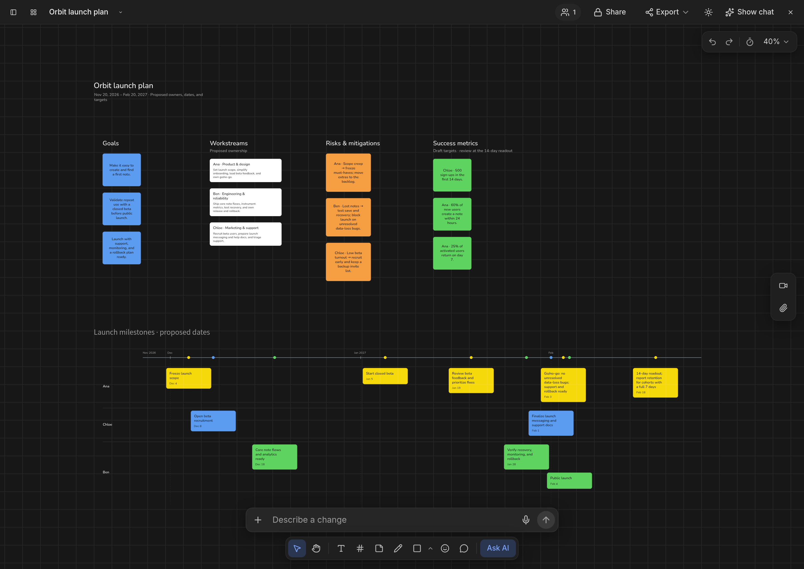
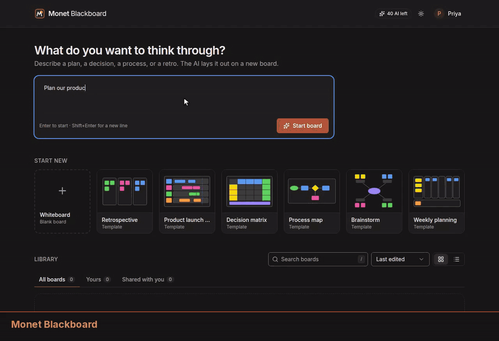
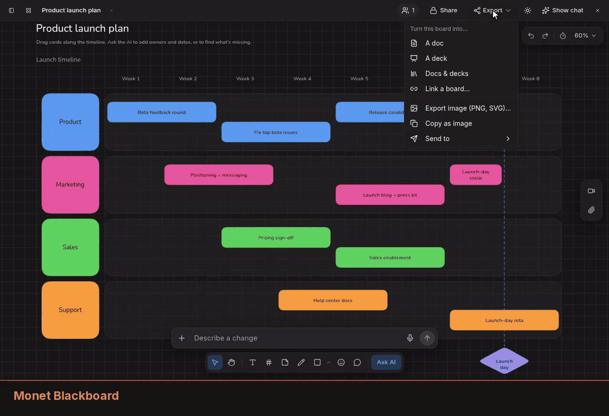
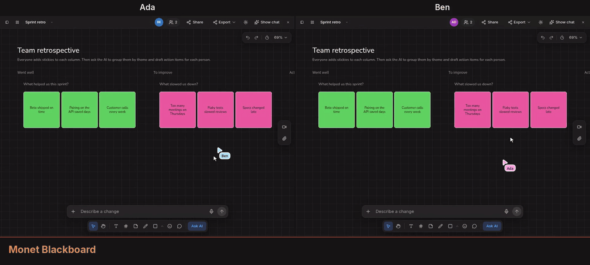

# Monet Blackboard

A self-hosted AI whiteboard. Describe what you need, paste a brain dump, drop in a file or talk through a meeting,
and the AI lays it out on an infinite canvas as sections, sticky notes, diagrams, timelines and charts. Then it keeps
working with you: it revises sections in place, finds gaps, cleans up layouts, answers questions about the board and
turns it into a document or a slide deck. Monet Blackboard runs on your own computer with your own Anthropic or
OpenAI API key and PostgreSQL. There's no account, sign-up or hosted service.

The canvas is [Excalidraw](https://github.com/excalidraw/excalidraw), so everything the AI makes is ordinary,
editable whiteboard content.



## Features

- **Boards from a prompt**: plans, brain dumps, timelines, retros, process maps, decision matrices and visual
  explainers with stat cards and charts, built live on the canvas
- **An AI that edits what's there**: revise a section in place, regroup by theme, find what's missing (as suggestions
  you accept or dismiss), clean up overlaps, address comments, count votes, or act on just your selection
- **Files and sketches**: CSV, PDF, text and images become structured boards; rough sketches become clean diagrams
- **Live meeting mode**: the board builds itself from what people say, a chunk at a time, without duplicates
- **Docs and decks** written from the board, downloadable as Word, PowerPoint or Markdown
- **Web search with sources** for questions about current facts (through your provider)
- **Whiteboard tools**: sticky notes, sections, shapes and connectors, comments, stickers, votes, a shared timer, cursor
  chat, polls, calculators, clickable prototypes and video embeds, six templates, light and dark themes
- **Export** to PNG or SVG, copy as an image, or send to Miro, Lucid, draw.io or Excalidraw
- **Optional team mode**: share a board link; people join with just a name and edit live with cursors, follow mode and
  roles (editor, commenter, viewer)

| Describe a plan, and the AI lays it out live   | Turn any board into a doc or a slide deck    |
| ---------------------------------------------- | -------------------------------------------- |
|  |  |

**In team mode, everyone edits the same board live, and the AI works for the whole room**



## Quick start with Docker Compose

Requirements: Docker Engine with the Compose plugin, Git, and an Anthropic or OpenAI API key.

```sh
git clone https://github.com/Akshayab/monet-blackboard
cd monet-blackboard
cp .env.example .env    # then set ANTHROPIC_API_KEY or OPENAI_API_KEY
docker compose up -d --build
```

Open **http://localhost:3000**. Compose starts PostgreSQL alongside the app. Only the app's port is published, and only
on `127.0.0.1`; PostgreSQL isn't reachable from outside Compose. For backups and upgrades, see
[Self-hosting](docs/SELF_HOSTING.md).

## From source

Use Node.js **22.12+** (24 LTS recommended), pnpm **10.26.1** and PostgreSQL **14+**. Node 25 and later don't
include corepack; run `npm i -g corepack` first.

```sh
corepack enable
corepack prepare pnpm@10.26.1 --activate
pnpm install --frozen-lockfile
cp .env.example .env    # set your API key and DATABASE_URL
pnpm build
NODE_ENV=production pnpm start
```

Open **http://localhost:3000**. The server creates and migrates its tables before it starts listening. Rate limits
are strict unless `NODE_ENV` is `development` or `test`; `pnpm dev` sets `development` for you.

## Your model and API key

Set one key in `.env`:

| Provider          | Setting                                                        | Default model       |
| ----------------- | -------------------------------------------------------------- | ------------------- |
| Anthropic         | `ANTHROPIC_API_KEY`                                            | `claude-sonnet-5-5` |
| OpenAI            | `OPENAI_API_KEY`                                               | `gpt-6.2-sol`       |
| OpenAI-compatible | `AI_PROVIDER=openai-compatible`, `OPENAI_BASE_URL`, `AI_MODEL` | none                |

`AI_MODEL` picks a different model, and `AI_LIVE_MODEL` can point live meeting mode at a cheaper or faster one. The
OpenAI-compatible mode works with servers such as Ollama, LM Studio, vLLM or OpenRouter, as long as the model supports
tool calling; it has no web search, can't read PDFs (their text is sent when the browser can extract it), and the
board AI is only as good as the model behind it.

Every request goes to your provider on your key, so set a spend limit with your provider. Monet Blackboard also caps
AI use per rolling 24 hours: by default 1,000 requests and 5 million tokens for you, and in team mode 40 requests per
guest with 300 requests and 3 million tokens shared by all guests together. What guests use never counts against your
own allowance. Every limit is in [`.env.example`](.env.example).

Besides your AI provider, the app contacts nothing unless you ask it to: fonts, images and all other assets are served
from your server. The exceptions are things someone adds or you click: YouTube, Vimeo and Loom videos placed on a
board, links you open, and "Send to Miro" or "Send to Lucid", which use a token you paste for that one request. Other
links on a board show as cards and fetch nothing.
Dictation and live meeting mode use your browser's speech recognition; in Chrome, that audio is processed by Google.

## Solo mode and team mode

**Solo mode** is the default. There's no sign-in: the server listens on `127.0.0.1` and answers only requests
addressed to `localhost`, and only accepts changes from its own pages. Other websites you visit can't reach it, even
with DNS-rebinding tricks. Don't expose a solo-mode server to a network.

**Team mode** (`TEAM_MODE=1`) lets other people join your boards:

1. Start the server with `TEAM_MODE=1`. It prints an **owner link** (`/claim#...`) in the terminal or in
   `docker compose logs monet`. Open it once in your browser to become the owner there. Keep it private.
2. On a board, use **Share** to turn on a view or edit link and copy it.
3. People who open the link enter a name and join that board. Guests can't create boards, and only see boards they
   were given a link to. In the Share dialog you can set each person's role (it then holds even if the link would give
   more or is turned off) or remove them. Remove blocks that browser. To keep someone out for sure, reset the link.
   Turning a link off or resetting it cuts off everyone who joined through it.

Opening the owner link in another browser signs you in there too. `OWNER_LINK_ROTATE=1` makes a new link and signs the
owner out everywhere.

### Hosting for a team

People need to reach the server over HTTPS: browsers only allow the microphone and the clipboard on secure pages, and
session cookies are marked secure behind HTTPS. Either:

- **Use a tunnel** from your own computer, such as [Cloudflare Tunnel](https://developers.cloudflare.com/cloudflare-one/connections/connect-networks/),
  [Tailscale Funnel](https://tailscale.com/kb/1223/funnel) or [ngrok](https://ngrok.com/), pointed at
  `http://localhost:3000`. Set `PUBLIC_URL` to the tunnel's address.
- **Run it on a server** behind a reverse proxy that handles HTTPS. With Docker Compose, keep the port on
  `127.0.0.1` and put a proxy such as Caddy in front:

  ```
  board.example.com {
    reverse_proxy 127.0.0.1:3000
  }
  ```

  Set `TEAM_MODE=1` and `PUBLIC_URL=https://board.example.com` in `.env`. The proxy must pass WebSocket upgrades (Caddy
  and most proxies do by default). If it isn't on the same machine or a private network, list its address in
  `TRUST_PROXY`.

Run a single server process: live board state is kept in memory and saved to PostgreSQL within a couple of seconds of each change and on
shutdown, so several processes behind a load balancer would each see a different board.

See [SECURITY.md](SECURITY.md) for the full security model.

## Development

```sh
pnpm dev                # API on :3000 and the web app with hot reload on http://localhost:5173
pnpm typecheck
pnpm test               # server unit tests; no database, network or API key needed
pnpm format             # Prettier
```

The end-to-end suite drives real browsers through every flow, including two people editing one board. It runs against
a scripted stand-in model (`AI_MOCK=1`), so it needs no key; see [scripts/e2e/README.md](scripts/e2e/README.md).
`apps/server/test/ai-capabilities.mjs` checks 25 things people ask the AI to do against a real model.

The code is a pnpm monorepo: `apps/server` (Express API, realtime server and the board AI), `apps/web` (React, Vite
and Excalidraw), `lib/db` (Drizzle schema and migrations), `lib/board-protocol` (element builders and the realtime
protocol shared by both) and `scripts/e2e` (Playwright).

CI (`.github/workflows/ci.yml`) runs the format check, typechecks, unit tests, a dependency audit, the build, the
end-to-end suite, a Docker quick start on amd64 and arm64, and a secrets scan.

See [Contributing](CONTRIBUTING.md), [Security](SECURITY.md), [Self-hosting](docs/SELF_HOSTING.md),
[Licenses and checks](docs/AUDIT.md) and the [Changelog](CHANGELOG.md).

## License

[Apache License 2.0](LICENSE). Excalidraw (MIT), its fonts (SIL Open Font License 1.1, and MIT for Comic Shanns),
Inter (OFL 1.1) and the other bundled third-party code keep their own licenses; see [NOTICE](NOTICE),
[licenses/](licenses) and [THIRD_PARTY_LICENSES.md](THIRD_PARTY_LICENSES.md).

Monet Blackboard is an independent project. It isn't affiliated with or endorsed by Excalidraw, Anthropic, OpenAI,
Miro or Lucid.
